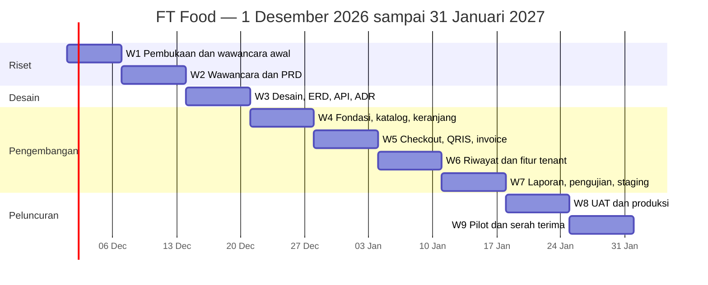

# 05 — Rencana Pelaksanaan 2 Bulan

**Periode:** Selasa, 1 Desember 2026 – Minggu, 31 Januari 2027
**Durasi:** 9 minggu kalender, 5 sprint
**Isi:** 35 issue • 197 poin • 7 milestone

> Dokumen ini adalah jadwal utama. Aturan kerja tim ada di [`docs/02-roadmap.md`](02-roadmap.md).

**Istilah singkat**

| Istilah | Arti |
| :--- | :--- |
| **PRD** | Dokumen kebutuhan produk |
| **MVP** | Versi pertama yang layak dipakai dan diuji |
| **ERD** | Rancangan struktur database |
| **API** | Penghubung antara tampilan dan data |
| **OpenAPI** | Dokumen kontrak API |
| **ADR** | Catatan keputusan teknis |
| **QRIS** | Pembayaran dengan kode QR standar Indonesia |
| **Webhook** | Pemberitahuan otomatis dari penyedia pembayaran |
| **Staging** | Lingkungan uji sebelum produksi |
| **UAT** | Pengujian oleh pengguna sebelum rilis |
| **E2E** | Pengujian alur dari awal sampai akhir |
| **P0/P1** | Tingkat bug: P0 paling berat, P1 berat |
| **G0–G8** | Titik pemeriksaan keputusan |
| **Sprint** | Blok kerja selama 1–2 minggu |
| **Milestone** | Target antara yang harus dicapai |
| **Issue** | Satu pekerjaan yang dicatat di GitHub |

## 1. Asumsi dan kemampuan tim

| Hal | Asumsi |
| :--- | :--- |
| Tim | 5 orang: PM/BA, UI/UX, Frontend, Backend, QA |
| Waktu kerja | ±20 jam per orang per minggu (sekitar 2,5 hari kerja) |
| Ukuran pekerjaan | 1 poin ≈ 4 jam |
| Total waktu tersedia | 5 orang × 20 jam × 9 minggu = 900 jam |
| Total pekerjaan | 197 poin × 4 jam = 788 jam |
| Cadangan | ±12,5% (sekitar 112 jam) untuk bug, koordinasi, dan libur |
| Hari libur | 25 Desember (Natal), 1 Januari (Tahun Baru); 24 dan 31 Desember setengah hari |
| QRIS | Akun sandbox diajukan paling lambat 14 Desember; akun live disetujui sebelum 15 Januari |

Rencana ini sudah diringkas agar lebih realistis. Jika waktu tim hanya **15 jam per orang per minggu**, pekerjaan tidak akan selesai tepat waktu. Gunakan pengurangan ruang lingkup di §7 atau tambah 2 minggu.

## 2. Jadwal sprint dan target antara

| Minggu | Tanggal | Sprint | Fokus | Poin | Target |
| :---: | :--- | :---: | :--- | ---: | :--- |
| **W1** | Sel 1 – Min 6 Des | Sprint 0 | Rapat pembuka, menyiapkan wawancara, mulai observasi | 5 | M0 berjalan |
| **W2** | Sen 7 – Min 13 Des | Sprint 1 | Menyelesaikan wawancara, PRD, mulai fondasi | 26 | **M0 — Discovery & PRD** (13 Des) |
| **W3** | Sen 14 – Min 20 Des | Sprint 1 | Wireframe, desain, ERD/API, ADR, QRIS sandbox | 35 | **M1 — Design & Technical Spec** (20 Des) |
| **W4** | Sen 21 – Min 27 Des | Sprint 2 | Login, komponen UI, daftar/detail tenant, keranjang, staging | 30 | **M2 — Foundation, Katalog & Keranjang** (27 Des) |
| **W5** | Sen 28 Des – Min 3 Jan | Sprint 2 | Checkout, QRIS, webhook, invoice, unit test | 28 | **M3 — Checkout, QRIS & Invoice** (3 Jan) |
| **W6** | Sen 4 – Min 10 Jan | Sprint 3 | Riwayat Cust, dashboard/antrean tenant, produk | 25 | **M4 — Riwayat & Dashboard Tenant** (10 Jan) |
| **W7** | Sen 11 – Min 17 Jan | Sprint 3 | Laporan, pencairan, E2E, keamanan, staging, kandidat rilis | 25 | **M5 — Laporan, Hardening & Staging** (17 Jan) |
| **W8** | Sen 18 – Min 24 Jan | Sprint 4 | UAT, perbaikan bug, peluncuran produksi, QRIS live | 11 | M6 berjalan |
| **W9** | Sen 25 – Min 31 Jan | Sprint 4 | Pelatihan, pilot, pemantauan, retrospektif, serah terima | 12 | **M6 — UAT, Deployment & Pilot** (31 Jan) |
| | | | **Total** | **197** | |

**Ringkasan sprint:**

| Sprint | Tanggal | Durasi | Poin | Catatan |
| :--- | :--- | :---: | ---: | :--- |
| Sprint 0 | 1–6 Des | 6 hari | 5 | Sprint pembuka untuk memulai riset |
| Sprint 1 | 7–20 Des | 2 minggu | 61 | Riset, desain, dan fondasi awal berjalan bersamaan |
| Sprint 2 | 21 Des–3 Jan | 2 minggu | 58 | Melewati Natal dan Tahun Baru, waktu kerja berkurang |
| Sprint 3 | 4–17 Jan | 2 minggu | 50 | Fitur tenant, laporan, dan pengujian |
| Sprint 4 | 18–31 Jan | 2 minggu | 23 | UAT, peluncuran, dan pilot |



## 3. Titik pemeriksaan yang tidak boleh dilewati

Titik pemeriksaan (gate) adalah keputusan resmi untuk lanjut ke tahap berikutnya. Jika syarat belum terpenuhi, tim harus memperbaiki dulu, bukan melanjutkan.

| Titik | Tanggal | Syarat lulus | Jika gagal |
| :--- | :--- | :--- | :--- |
| **G0** | Min 13 Des | PRD v1 disetujui; 15 Cust, 5 Tenant, dan 1 pengelola sudah diwawancarai; pertanyaan terbuka sudah diputuskan | Perpanjang riset maksimal 3 hari; jangan mulai membuat fitur |
| **G1** | Min 20 Des | ERD, OpenAPI, ADR, desain final, dan QRIS sandbox siap | Tunda pembuatan UI; selesaikan dokumen dan QRIS lebih dulu |
| **G2** | Min 27 Des | Login, daftar tenant, detail tenant, dan keranjang berjalan di staging | Pindahkan pekerjaan katalog ke W5; kurangi fitur opsional |
| **G3** | Min 3 Jan | Pembayaran sandbox berhasil sampai invoice tampil; webhook terverifikasi | Ini titik paling penting. Fokus ke pembayaran dan kurangi fitur opsional |
| **G4** | Min 10 Jan | Riwayat Cust, antrean Tenant, dan produk berjalan | Tunda foto produk; jangan tunda antrean |
| **G5** | Min 17 Jan | Laporan, E2E, keamanan, dan staging lulus; kandidat rilis siap | Tunda pilot; jangan kurangi pengujian keamanan |
| **G6** | Jum 22 Jan | UAT selesai dan disetujui; tidak ada bug P0/P1 | Perbaiki dulu; peluncuran dimundurkan |
| **G7** | Min 24 Jan | Produksi berjalan; QRIS live nominal kecil berhasil | Pilot dimundurkan; jangan memakai QRIS manual di luar ruang lingkup |
| **G8** | Min 31 Jan | Pilot selesai; serah terima dan retrospektif selesai | Catat utang teknis; jangan menyatakan selesai jika belum |

## 4. Rencana harian

### W1 — 1–6 Desember (Sprint 0): mulai dari wawancara

| Hari | Fokus | Kegiatan |
| :--- | :--- | :--- |
| **Sel 1 Des** | Rapat pembuka | DISC-01: tujuan, ruang lingkup, peta pihak terkait, dan pembagian peran. Mulai DISC-02: susun panduan wawancara dan lembar persetujuan. Buka pendaftaran 15 Cust dan 5 Tenant. |
| **Rab 2 Des** | Menyiapkan wawancara | Selesaikan DISC-02. Hubungi tenant melalui pengelola. Ajukan akun QRIS sandbox lebih awal. Siapkan repository dan papan pekerjaan. |
| **Kam 3 Des** | Uji coba wawancara | Uji satu wawancara Cust dan satu Tenant. Perbaiki pertanyaan yang terlalu mengarahkan. Uji cara mencatat tanpa nama asli. |
| **Jum 4 Des** | Wawancara dan observasi | Mulai DISC-03: Cust 1–4, Tenant 1. Observasi jam sibuk: hitung antrean, waktu tunggu, dan cara bayar. |
| **Sab 5 Des** | Wawancara | Cust 5–8 dan Tenant 2. Mulai mengumpulkan bahan perbandingan aplikasi untuk DISC-05. |
| **Min 6 Des** | Merapikan hasil | Rapikan catatan, cek jumlah peserta, dan susun jadwal W2. Tinjauan mingguan 30 menit. |

**Hasil W1:** panduan wawancara final, 8+ Cust, 2+ Tenant, 1 sesi observasi, daftar peserta W2, repository dan papan siap.

### W2 — 7–13 Desember (Sprint 1): PRD dan fondasi

| Hari | Fokus | Kegiatan |
| :--- | :--- | :--- |
| **Sen 7 Des** | Wawancara dan fondasi | Cust 9–12; observasi kedua. Mulai DEV-01: repository, CI, environment, dan struktur database. |
| **Sel 8 Des** | Wawancara | Cust 13–15, Tenant 3, dan wawancara pengelola/keuangan. Lanjutkan DEV-01. |
| **Rab 9 Des** | Menyusun hasil | Tenant 4–5. Selesaikan wawancara. Mulai DISC-04: kelompokkan temuan dan nilai dampaknya. Selesaikan DEV-01. |
| **Kam 10 Des** | Persona dan ruang lingkup | DISC-04: persona dan peta perjalanan. DISC-05: bandingkan aplikasi dan tentukan fitur wajib. |
| **Jum 11 Des** | Menyusun PRD | DISC-05: tulis draf PRD dan review bersama pengelola/dosen. DES-01: susun peta halaman dan alur. |
| **Sab 12 Des** | Revisi | Perbaiki PRD dan minta persetujuan. Mulai wireframe kasar dan bahas kontrak API dengan Backend. |
| **Min 13 Des** | **G0 / M0** | PRD disetujui. Tunjukkan hasil riset kepada pihak terkait. Rencanakan Sprint 1. |

**Hasil W2:** PRD v1 disetujui, 5 masalah utama terbukti, persona dan alur pengguna, peta halaman, repository + CI + environment + database siap.

### W3 — 14–20 Desember (Sprint 1): desain dan spesifikasi teknis

| Hari | Fokus | Kegiatan |
| :--- | :--- | :--- |
| **Sen 14 Des** | Peta alur dan QRIS | DES-01: peta halaman dan alur. DES-06: ajukan/urus akun QRIS sandbox. |
| **Sel 15 Des** | Wireframe | DES-02: wireframe Cust dan Tenant. Bahas alur dengan Frontend/Backend. |
| **Rab 16 Des** | Desain dan data | DES-03: desain visual dan komponen. DES-04: ERD, kontrak API, dan status pesanan. |
| **Kam 17 Des** | Desain dan keputusan teknis | Lanjutkan DES-03/DES-04. DES-05: ADR teknologi, kebutuhan non-fungsional, dan strategi pengujian. |
| **Jum 18 Des** | Uji desain | DES-02: 3 Cust dan 2 Tenant menguji prototipe. Catat masalah dan perbaiki yang kritis. |
| **Sab 19 Des** | Serah terima desain | Finalkan desain dan catatan developer. Review ERD, OpenAPI, dan status pesanan. Verifikasi QRIS sandbox. |
| **Min 20 Des** | **G1 / M1** | Desain dan spesifikasi teknis disetujui. Rencanakan Sprint 2. |

**Hasil W3:** desain final, wireframe teruji, ERD, OpenAPI, ADR, status pesanan, kebutuhan non-fungsional, QRIS sandbox.

### W4 — 21–27 Desember (Sprint 2): fondasi dan katalog

| Hari | Fokus | Kegiatan |
| :--- | :--- | :--- |
| **Sen 21 Des** | Login dan akses | DEV-02: register/login/logout, hak akses, dan format error. |
| **Sel 22 Des** | Komponen dan katalog | Selesaikan DEV-02. DEV-03: layout dan komponen dasar. |
| **Rab 23 Des** | Daftar dan detail tenant | DEV-04: API dan halaman daftar tenant. DEV-05: detail tenant dan tombol tambah. |
| **Kam 24 Des** | Setengah hari | DEV-06: keranjang dan halaman checkout. OPS-02: peluncuran staging. |
| **Jum 25 Des** | Libur Natal | Tidak ada kewajiban commit. |
| **Sab 26 Des** | Cadangan | Uji login → daftar → detail → keranjang. Perbaiki bug. |
| **Min 27 Des** | **G2 / M2** | Demo alur katalog dan keranjang. Rencanakan Sprint 3. |

**Hasil W4:** login, komponen dasar, daftar/detail tenant, keranjang, checkout, staging aktif.

### W5 — 28 Desember–3 Januari (Sprint 2): checkout dan QRIS

| Hari | Fokus | Kegiatan |
| :--- | :--- | :--- |
| **Sen 28 Des** | API checkout | DEV-07: buat pesanan, hitung ulang harga di server, simpan salinan harga, cegah pesanan ganda. |
| **Sel 29 Des** | Integrasi QRIS | DEV-08: buat pembayaran QRIS, simpan referensi, dan siapkan halaman QR. |
| **Rab 30 Des** | Tampilan QRIS | DEV-08: tampilkan QR, nominal, hitung mundur, dan cek status berkala. |
| **Kam 31 Des** | Setengah hari | DEV-09: webhook dan pencegahan proses ganda. QA-01: unit test. |
| **Jum 1 Jan** | Libur Tahun Baru | Tidak ada kewajiban commit. |
| **Sab 2 Jan** | Invoice dan kegagalan | DEV-10: invoice, kedaluwarsa, gagal, dan coba ulang. Uji sandbox sampai invoice. |
| **Min 3 Jan** | **G3 / M3** | Demo pembayaran sandbox berhasil, status berubah, invoice tampil. |

**Hasil W5:** pesanan, QRIS sandbox, webhook, invoice, unit test.

### W6 — 4–10 Januari (Sprint 3): riwayat dan fitur tenant

| Hari | Fokus | Kegiatan |
| :--- | :--- | :--- |
| **Sen 4 Jan** | Riwayat Cust | DEV-11: daftar dan detail riwayat pemesanan. |
| **Sel 5 Jan** | Dashboard tenant | DEV-12: dashboard, status buka/tutup, dan API antrean. |
| **Rab 6 Jan** | Antrean | DEV-12: halaman antrean dan aksi Proses/Selesai. |
| **Kam 7 Jan** | Produk | DEV-13: tambah, ubah, arsip produk, foto, dan tombol tersedia/habis. |
| **Jum 8 Jan** | Integration test | QA-02: uji login, pesanan, webhook, antrean, dan produk. Perbaiki bug. |
| **Sab 9 Jan** | Persiapan demo | Uji alur tenant: pesanan masuk → proses → selesai; produk habis. |
| **Min 10 Jan** | **G4 / M4** | Demo riwayat Cust dan antrean/produk Tenant. Rencanakan Sprint 4. |

**Hasil W6:** riwayat, dashboard tenant, antrean, produk, integration test.

### W7 — 11–17 Januari (Sprint 3): laporan dan pengujian

| Hari | Fokus | Kegiatan |
| :--- | :--- | :--- |
| **Sen 11 Jan** | Laporan dan infrastruktur | DEV-14: omzet hari ini dan pencairan. OPS-01: infrastruktur produksi, domain, backup. |
| **Sel 12 Jan** | E2E | Selesaikan DEV-14. QA-03: E2E Cust dan Tenant. |
| **Rab 13 Jan** | QRIS dan keamanan | QA-04: uji QRIS dan webhook. Mulai pemeriksaan keamanan. |
| **Kam 14 Jan** | Perbaikan | QA-04: uji akses data, validasi input, dan performa. Perbaiki bug P0/P1. |
| **Jum 15 Jan** | Kandidat rilis | Bekukan fitur. Siapkan skenario UAT dan data uji. |
| **Sab 16 Jan** | Perbaikan bug bersama | Uji ulang alur utama, perbaiki bug kritis, siapkan data UAT. |
| **Min 17 Jan** | **G5 / M5** | Kandidat rilis disetujui. Tidak ada fitur baru setelah tanggal ini. |

**Hasil W7:** laporan dan pencairan, E2E, pemeriksaan keamanan, staging stabil, kandidat rilis.

### W8 — 18–24 Januari (Sprint 4): UAT dan peluncuran

| Hari | Fokus | Kegiatan |
| :--- | :--- | :--- |
| **Sen 18 Jan** | UAT Cust | QA-05: 5 Cust mencoba pesan, bayar, invoice, dan riwayat. |
| **Sel 19 Jan** | UAT Tenant | QA-05: 3 Tenant mencoba antrean, proses/selesai, produk, dan laporan. |
| **Rab 20 Jan** | Perbaikan bug | Kelompokkan bug P0/P1, perbaiki, lalu uji ulang. |
| **Kam 21 Jan** | Pemeriksaan akhir | Periksa keamanan dan hak akses. Cek backup dan rencana pembatalan perubahan. |
| **Jum 22 Jan** | **G6** | UAT disetujui dan keputusan lanjut/tidak. Jika gagal, peluncuran dimundurkan. |
| **Sab 23 Jan** | Peluncuran | OPS-03: peluncuran produksi, migrasi database, uji singkat, webhook produksi. |
| **Min 24 Jan** | **G7** | Transaksi QRIS live nominal kecil. Periksa invoice dan antrean. Waktu cadangan. |

**Hasil W8:** UAT disetujui, produksi berjalan, QRIS live terverifikasi.

### W9 — 25–31 Januari (Sprint 4): pilot dan serah terima

| Hari | Fokus | Kegiatan |
| :--- | :--- | :--- |
| **Sen 25 Jan** | Pelatihan dan pilot | OPS-04: latih Tenant dan pasang poster/FAQ. OPS-05: pilot hari 0. |
| **Sel 26 Jan** | Pilot hari 1 | Pantau transaksi, error, dan webhook. Catat keluhan. |
| **Rab 27 Jan** | Pilot hari 2 | Perbaiki bug P0/P1. Beri informasi kepada tenant. |
| **Kam 28 Jan** | Pilot hari 3 | Periksa omzet dan pencairan. Cocokkan pembayaran. |
| **Jum 29 Jan** | Pilot hari 4 | Survei singkat Cust dan Tenant. Catat masukan. |
| **Sab 30 Jan** | Pilot hari 5 | Stabilkan sistem. Siapkan laporan pilot. |
| **Min 31 Jan** | **G8 / M6** | OPS-05: retrospektif, daftar pekerjaan versi 1.1, serah terima akses/runbook, laporan akhir. |

**Hasil W9:** pilot selesai, metrik tercatat, retrospektif, daftar perbaikan berikutnya, serah terima.

## 5. Pembagian issue per minggu

| Minggu | Sprint | Issue | Jumlah | Poin |
| :---: | :---: | :--- | ---: | ---: |
| W1 | 0 | DISC-01, DISC-02 | 2 | 5 |
| W2 | 1 | DISC-03, DISC-04, DISC-05, DEV-01 | 4 | 26 |
| W3 | 1 | DES-01…DES-06 | 6 | 35 |
| W4 | 2 | DEV-02…DEV-06, OPS-02 | 6 | 30 |
| W5 | 2 | DEV-07…DEV-10, QA-01 | 5 | 28 |
| W6 | 3 | DEV-11…DEV-13, QA-02 | 4 | 25 |
| W7 | 3 | DEV-14, QA-03, QA-04, OPS-01 | 4 | 25 |
| W8 | 4 | QA-05, OPS-03 | 2 | 11 |
| W9 | 4 | OPS-04, OPS-05 | 2 | 12 |
| | | **Total** | **35** | **197** |

**Cara mengisi papan:** isi kolom `Sprint` sesuai tabel, `Start date` dengan hari Senin minggu tersebut, dan `Target date` dengan hari Minggu di akhir minggu. Issue yang belum selesai tetap berstatus `In Progress` sampai semua kriteria selesai terpenuhi.

## 6. Alur yang paling menentukan

Alur berikut tidak boleh terlambat karena akan menahan pekerjaan lain:

```
Wawancara → PRD → Desain/ERD/API → Login → Checkout → QRIS → Webhook → Invoice
   ↓
Antrean tenant → Produk → Laporan/Pencairan → UAT → Produksi → Pilot
```

1. **QRIS sandbox (14–20 Des).** Tanpa ini, pembayaran tidak dapat diuji pada W5.
2. **ERD dan OpenAPI (20 Des).** Tanpa ini, Frontend dan Backend akan saling menunggu.
3. **Webhook dan pencegahan proses ganda (3 Jan).** Tanpa ini, status pesanan tidak dapat dipercaya.
4. **Antrean tenant (10 Jan).** Tanpa ini, alur kerja tenant tidak dapat diuji.
5. **Keamanan dan UAT (17–22 Jan).** Tanpa ini, aplikasi tidak boleh diluncurkan.

## 7. Pengurangan ruang lingkup jika tertinggal

Karena daftar sudah diringkas menjadi 35 issue, pengurangan dilakukan dengan menyederhanakan isi pekerjaan, bukan menghapus fitur utama.

**Bisa disederhanakan:**

- Uji kegunaan DES-02: cukup 3 responden, bukan 5.
- Foto produk DEV-13: gunakan gambar contoh terlebih dahulu.
- Cetak invoice DEV-10: cukup gunakan fitur cetak browser.
- Riwayat pencairan DEV-14: tampilkan status terbaru dan total, belum rincian tiap transfer.
- Coba ulang QRIS DEV-10: satu kali percobaan.
- Uji performa QA-04: cukup uji singkat.
- Poster/FAQ di OPS-04: buat versi sederhana.
- Retrospektif OPS-05: cukup 30 menit.

**Jangan dikurangi:** hak akses, verifikasi pembayaran/webhook, invoice, antrean tenant, UAT, backup, dan pemeriksaan keamanan.

Jika waktu tim hanya **15 jam per orang per minggu**, tambah 2 minggu atau kurangi fitur opsional di atas sejak awal.

## 8. Kegiatan rutin dan aturan papan

| Kegiatan | Jadwal | Durasi |
| :--- | :--- | :---: |
| Daily sync | Setiap hari pukul 08.30 (boleh tertulis) | 15 menit |
| Demo mingguan | Minggu pukul 19.00 | 30 menit |
| Perencanaan sprint | Awal sprint (6 Des, 20 Des, 3 Jan, 17 Jan) | 60 menit |
| Retrospektif | Akhir sprint | 30 menit |
| Tinjauan titik pemeriksaan | Sesuai §3 | 30 menit |

**Aturan:**

- Tidak ada fitur baru setelah **16 Januari** (pembekuan fitur). Hanya bug P0/P1 yang diperbaiki.
- PR harus kecil dan direview dalam 24 jam.
- Issue fitur memakai `Refs`, bukan `Closes`, agar tidak tertutup sebelum QA.
- Setiap titik pemeriksaan yang gagal dicatat sebagai risiko dan keputusan, bukan dibiarkan.

## 9. Risiko khusus jadwal 2 bulan

| Risiko | Dampak | Cara mengurangi |
| :--- | :---: | :--- |
| Libur Natal dan Tahun Baru mengurangi waktu kerja | Tinggi | Selesaikan pekerjaan penting di W1–W3; kurangi isi opsional; jangan letakkan titik pemeriksaan pada 25 Des/1 Jan |
| QRIS live belum disetujui | Tinggi | Ajukan 14 Des; UAT memakai sandbox; pilot menunggu persetujuan; jangan memakai QRIS manual |
| Wawancara melebihi jadwal | Tinggi | Dua pewawancara berjalan paralel; target 4–5 sesi per hari; hentikan wawancara pada 9 Des |
| Permintaan fitur baru | Tinggi | Gunakan PRD dan perubahan resmi; permintaan baru masuk daftar versi 1.1 |
| Bug pembayaran atau webhook | Tinggi | QA-04 pada W7; cocokkan data harian; pantau error |
| Waktu tim kurang dari 15 jam per orang | Tinggi | Gunakan pengurangan ruang lingkup atau tambah 2 minggu |
| Peserta UAT sulit didapat | Sedang | Ambil dari responden wawancara; jadwalkan 18–19 Jan sejak W2 |
| Peluncuran produksi gagal | Tinggi | Latihan peluncuran W7; uji backup dan pembatalan perubahan; lakukan peluncuran Sabtu 23 Jan dengan cadangan Minggu 24 Jan |
